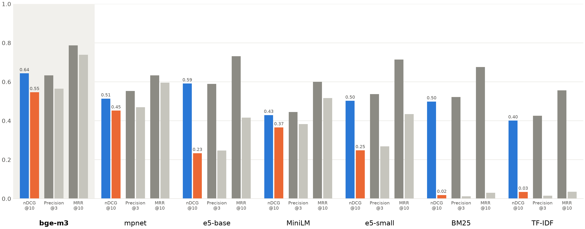

# luiss-cinemadb

Cinema ticketing database and application for the LUISS "Databases & Big Data" course. It combines a MySQL 9 database with a Python command-line application, a FastAPI backend and embedding-based movie recommendations.

## Repository layout

| Path | Contents |
| --- | --- |
| `ER_diagram.pdf` | ER diagram (source: `docs/er/ER_diagram.drawio`) |
| `schema.sql` | Tables, keys, constraints and indexes |
| `data.sql` | Synthetic test data |
| `queries.sql` | The five graded SQL queries |
| `src/` | Core logic and the command-line application |
| `api/` | FastAPI backend for the web app |
| `web/` | React frontend |
| `pipeline/` | Embedding model selection experiments |
| `tests/` | pytest suite |
| `docs/adr/` | Architecture decision records |
| `GLOSSARY.md` | Domain vocabulary |

## Requirements

- MySQL >= 9.0 (the schema uses the `VECTOR` type), or Docker
- Python 3.12 with [uv](https://docs.astral.sh/uv/), or pip
- [bun](https://bun.sh/) for the web app

## Creating the database

With Docker, copy the example environment file and start the database container:

```sh
cp .env.example .env
docker compose up -d
```

`docker-compose.yml` starts `mysql:9.7` and mounts `schema.sql` and `data.sql` into `/docker-entrypoint-initdb.d/`, so both files run in order on the first start of an empty volume. To recreate and re-seed the database from scratch, remove the volume with `docker compose down -v` and run `docker compose up -d` again.

Without Docker, use a local MySQL >= 9.0 server, create a database and user matching `.env` (by default `cinema` and `cinema`), and load `schema.sql`:

```sh
mysql -u cinema -p cinema < schema.sql
```

## Populating the database

Docker loads `data.sql` automatically on first start. Without Docker, load it after `schema.sql`:

```sh
mysql -u cinema -p cinema < data.sql
```

Then compute and store the movie embeddings in `movie_embedding`:

```sh
uv run cinema embed
```

The first run downloads `BAAI/bge-m3` from Hugging Face (about 2.3 GB). Because embeddings are generated outside `data.sql`, `uv run cinema embed` must be rerun after re-seeding or changing movies (see [docs/adr/0003-mysql-9-vector-for-embeddings.md](docs/adr/0003-mysql-9-vector-for-embeddings.md)).

The movies in `data.sql` are taken from [The Ultimate 1Million Movies Dataset (TMDB + IMDb)](https://www.kaggle.com/datasets/alanvourch/tmdb-movies-daily-updates) on Kaggle: their titles, release dates, running times, original languages, genres and descriptions are copied from the dataset unchanged. Everything else (available languages, theaters, users, payment methods, screenings and purchases) is synthetic.

## Running the command-line application

Install the dependencies and run the CLI with `uv`:

```sh
uv sync
uv run cinema
```

Without `uv`, install the CLI dependencies and the package in editable mode with `pip`, then run `cinema`:

```sh
pip install -r requirements.txt
pip install -e .
cinema
```

`requirements.txt` contains only the CLI dependencies, not the API ones. Database connection settings are read from `.env` (`DB_HOST`, `DB_PORT`, `DB_NAME`, `DB_USER`, `DB_PASSWORD`). After logging in, the app shows the client menu or the administrator menu depending on the user's role.

All clients in `data.sql` have the password `cinema123`, and the administrator (`admin@example.com`) has `asqlroma`.

## Running the web app

The React frontend in `web/` is still to be developed.

Start the FastAPI backend with:

```sh
uv run uvicorn api.main:app --reload
```

It listens on `http://127.0.0.1:8000` with interactive docs at `/docs` and exposes routes under `/api`. Logging in stores the user in a signed session cookie keyed by `SESSION_SECRET` in `.env`, and the routes call the same functions in `src/` as the CLI (see [docs/adr/0001-cli-is-the-graded-interface.md](docs/adr/0001-cli-is-the-graded-interface.md)).

## Design assumptions

- A user has exactly one role, and an administrator never buys tickets.
- Clients and administrators come from `data.sql`; there is no sign-up.
- Passwords are stored as bcrypt hashes.
- Tickets are counted per purchase and have no assigned seats.
- A purchase records its client through its payment method: `purchase` has no `client_id` column, because the client is always the owner of the payment method used, and storing it again would be redundant.
- A payment method that has been used for a purchase can't be removed.
- A payment method's type is either credit or debit. Card numbers in the data are fake and are displayed masked to the last 4 digits. The billing address is optional for both types.
- A card number can be registered only once, so a payment method is invalid if it is already registered, or fails the format and Luhn check when registered.
- The 20% discount applies to the base price plus surcharges. A movie released exactly two years before the screening gets no discount.
- A movie's original language is always one of its available languages.
- Consecutive screenings in a theater must be at least 10 minutes apart.
- A screening can only be added for a start time in the future.
- Tickets can't be bought for a screening that has already started.
- Screening search matches any part of the movie title, and a time criterion returns screenings starting at or after that time.
- Seed dates in `data.sql` are relative to the current date, so re-seeding gives upcoming screenings.
- The catalog has 30 movies, more than the suggested 6-8, so recommendations are meaningful.
- Available languages are not in the dataset and are our own choice: most movies have their original language and an Italian dub, a few also have English, and some are shown only in their original language.
- Interest descriptions can be written in English or Italian. Movie texts are in English, and the embedding model is multilingual, so both languages are compared in the same vector space.
- Recommendations cover the whole catalog, including movies with no upcoming screening.
- Some stored values can be derived from other data, and are kept on purpose: `screening.tickets_sold` (the sum of its purchases' tickets, required by the brief and kept in sync by the booking transaction), `purchase.total_amount` (the amount actually charged, which stays right if prices or theaters change later), `client.role` (always `client`, needed by the foreign key to `user`) and `movie_embedding` (regenerated by `cinema embed`).
- Every movie has an embedding: `cinema embed` is run after seeding, and the app does not check for missing or outdated embeddings.

## Booking transaction

Ticket booking is implemented in `buy_tickets` (`src/booking.py`). Database connections open with `autocommit=True` (`src/database.py`), and `buy_tickets` starts one transaction explicitly with `conn.start_transaction()`:

1. Checks that the payment method belongs to the client.
2. Reads the screening joined with its theater and movie using `SELECT ... FOR UPDATE OF s`, locking the screening row so a concurrent buyer for the same screening waits.
3. Rejects missing screenings, screenings that have already started and purchases of more tickets than the available seats.
4. Computes the ticket price in Python (`src/pricing.py`).
5. Inserts the purchase row and increments `screening.tickets_sold`.
6. Commits, or rolls back on any exception.

To run the test suite (with the MySQL container running):

```sh
uv run pytest
```

`tests/conftest.py` connects as `root` with `MYSQL_ROOT_PASSWORD` (default `root`) and rebuilds a separate `cinema_test` database from `schema.sql` and `data.sql` before each test, so the `cinema` database is never touched. See [tests/README.md](tests/README.md) for the mapping from the brief's test cases to test files.

Two tests target failure and concurrency behavior:

- Rollback (`tests/test_booking.py`): wraps the cursor so `UPDATE screening` fails after `INSERT INTO purchase` has run, then checks that no purchase was stored and `tickets_sold` is unchanged.
- Concurrency (`tests/test_concurrency.py`): uses two independent database connections in two threads on screening 9 (theater capacity 10, 9 tickets sold). The first buyer holds the `FOR UPDATE OF s` lock for one second while the second attempts to buy; the test checks one success, one "Not enough seats" failure, 10 tickets sold and no purchase stored for the second buyer.

## Movie recommendations

Recommendations are implemented in `src/recommendation.py` and exposed under "Get movie recommendations" in the client menu and `POST /api/recommendations`.

Each movie is formatted from its title, release year, alphabetical comma-separated genres and description as `{title} ({year}). {genres}. {description}` (omitting genres if a movie has none). Texts are embedded with `BAAI/bge-m3` through `sentence-transformers` into L2-normalized 1024-dimension vectors and stored in `movie_embedding` as MySQL `VECTOR`. Because the model is multilingual, English and Italian descriptions work without translation.

At request time, the client's description is embedded with the same model and scored against the stored vectors by cosine similarity, computed in Python with NumPy as a dot product of normalized vectors (MySQL's `DISTANCE()` is HeatWave-only). Movies are sorted by similarity from highest to lowest, returning the top three, or all movies if fewer than three have embeddings.

For model selection, [pipeline/README.md](pipeline/README.md) compares 7 methods (TF-IDF, BM25 and five multilingual embedding models) on 108 queries in English and Italian over a public TMDB/IMDb corpus. `BAAI/bge-m3` had the highest mean nDCG@10 averaged equally over both languages at 0.595 (0.643 in English and 0.546 in Italian, from [pipeline/results/summary.csv](pipeline/results/summary.csv)).



## Contributions

| Member | Contribution |
| --- | --- |
| Riccardo Palleschi | `schema.sql`, `data.sql`, `queries.sql`, Python application |
| Mattia Galentino | `schema.sql`, `data.sql`, `queries.sql`, Python application |
| Claudio De Acutis | Embedding model selection pipeline, movie recommendations |
| Luka Burmazevic | APIs, web frontend |
| Silvia Monteleone | ER diagram |
| Lapo Chiaselotti | ER diagram |

Everyone contributed to the design assumptions, the final documentation and the demo.
